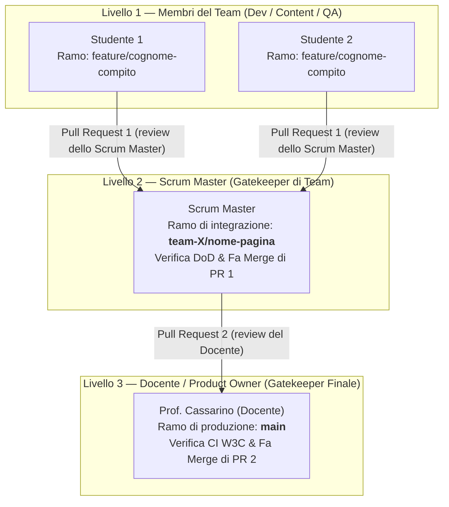

# 🏔️ Flusso di Lavoro a Piramide — Regole per la Classe 5ITB

Questo documento definisce il flusso rigoroso a due livelli di Pull Request (*Hierarchical Code Review*) applicato per tutti gli Sprint del progetto.



---

## 👥 Ruoli e Responsabilità

### 1. Membri del Team (Developer, Product Specialist, QA)
* Non lavorano mai direttamente né su `main` né sul branch del team (`team-X/...`).
* Creano sempre un proprio ramo personale partendo dal ramo del team:
  ```bash
  git checkout team-X/<pagina>
  git checkout -b feature/<proprio-cognome>-<compito>
  ```
* Quando la modifica è pronta e testata localmente, fanno il push del proprio ramo personale:
  ```bash
  git push -u origin feature/<proprio-cognome>-<compito>
  ```
* Aprono la **Pull Request 1** su GitHub:
  * **Base branch (destinazione):** `team-X/<pagina>`
  * **Compare branch (sorgente):** `feature/<proprio-cognome>-<compito>`
  * Assegnano come **Reviewer** il proprio Scrum Master.

---

### 2. Scrum Master in Carica (Sprint 1)
* **Team 1 (Sentieri):** Cristian Piccoli
* **Team 2 (Sport):** Tommaso Cortina
* **Team 3 (Rifugi):** Kevin Curto
* **Team 4 (Info):** Giovanna David

#### Compiti dello Scrum Master:
1. Sposta l'Issue su GitHub Projects da *To Do* a *In Progress*.
2. Revisiona la **Pull Request 1** dei compagni verificando la Definition of Done:
   * Zero tag `<div>` e zero `<span>`.
   * Testi autentici del Nevegal (niente *lorem ipsum*).
   * Tabelle accessibili (`<caption>`, `scope`).
3. Se conforme, approva ed esegue il **Merge** su `team-X/<pagina>`.
4. A fine lezione, apre la **Pull Request 2**:
   * **Base branch (destinazione):** `main`
   * **Compare branch (sorgente):** `team-X/<pagina>`
   * Assegna come **Reviewer** il Docente (`makiumjs`).
5. Sposta l'Issue su GitHub Projects in colonna *In Review*.

---

### 3. Docente (Product Owner)
* `main` è protetto: nessun commit diretto consentito.
* Il docente riceve al massimo **4 Pull Request** (una per ogni Scrum Master).
* Verifica la pipeline automatica W3C Validator e valida il rilascio in produzione unendo su `main`.
