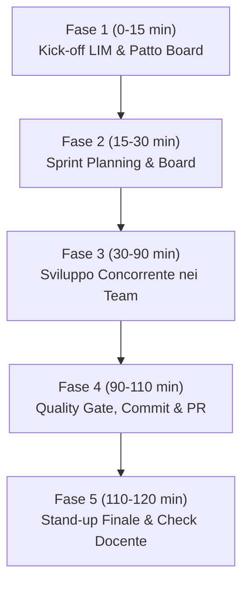

# 🚀 Piano Operativo di Lezione — Passaggio a Sprint 1 (Classe 5ITB)
**Materia:** Gestione Progetto e Organizzazione d'Impresa (GPOI) — Laboratorio ICT  
**Progetto:** Portale Web Monte Nevegal  
**Durata:** 2 ore di laboratorio (120 minuti)  
**Docente:** Prof. Marco Cassarino (ITP)

---

## 🎯 Obiettivo della Lezione
Transizione ufficiale da *Sprint 0 (Setup & Onboarding)* ad **AVVIO UFFICIALE SPRINT 1** (Setup Architetturale, Fondamenta Semantiche e Contenuti Reali).  
Insediamento della governance agile: rispetto dei limiti WIP e **controllo esclusivo della Board Scrumban da parte dei soli Scrum Master**.

---

## 🔒 REGOLA D'ORO DI GOVERNANCE (Da Proiettare alla LIM)

> ⚠️ **AUTORITÀ ESCLUSIVA DELLA BOARD GITHUB:**  
> **SOLO gli Scrum Master in carica hanno il permesso di modificare, assegnare e spostare le Issue tra le colonne della bacheca (*To Do* $\rightarrow$ *In Progress* $\rightarrow$ *In Review* $\rightarrow$ *Done*).**
> * I *Core Developer* e i *Product Specialist* lavorano sul codice e sui contenuti, ma **non possono trascinare le schede**.
> * Quando un'attività è pronta per la verifica, lo sviluppatore/content specialist chiede il passaggio di stato durante il mini stand-up al proprio Scrum Master.
> * Lo Scrum Master sposta l'Issue in *Done* **solo dopo** che il responsabile *QA & Accessibilità* ha convalidato la conformità alla *Definition of Done* (zero `<div>`/`<span>`, accessibilità WCAG, semaforo verde CI W3C).

---

## 👥 Gli Scrum Master in Carica per lo Sprint 1

| Feature Team | Pagina Assegnata | Branch Dedicato | Scrum Master Ufficiale (Sprint 1) | Compiti di Governance Odierni |
| :--- | :--- | :--- | :--- | :--- |
| **Team 1 — Sentieri** | `sentieri.html` | `team-1/sentieri` | **Cristian Piccoli** | Spostare Issue #1 in *In Progress*, verificare allineamento branch con Borra e De Simoi. |
| **Team 2 — Sport** | `sport.html` | `team-2/sport` | **Tommaso Cortina** | Spostare Issue #2 in *In Progress*, verificare creazione branch e coordinare Gaio e D'Incau. |
| **Team 3 — Rifugi** | `rifugi.html` | `team-3/rifugi` | **Kevin Curto** | Spostare Issue #3 in *In Progress*, coordinare bozza testi autentici con Bonetto. |
| **Team 4 — Info & Sicurezza** | `info.html` | `team-4/info` | **Giovanna David** | Spostare Issue #4 in *In Progress*, revisionare primo commit di Cristina Ye e pianificare mobilità. |

---

## ⏱️ Cronoprogramma Operativo (120 Minuti)



### 1. Fase 1: Kick-off alla LIM & Regole di Governance (0 – 15 min)
* Proiezione di GitHub Projects / Issues alla lavagna.
* Enunciazione della regola: solo i 4 Scrum Master governano la bacheca.
* Presentazione dei criteri di valutazione GPOI per lo Sprint 1 (DoD semantica e W3C).

### 2. Fase 2: Sprint Planning & Presa in Carico (15 – 30 min)
* **Azione Scrum Master:**
  * Cristian Piccoli, Tommaso Cortina, Kevin Curto e Giovanna David aprono GitHub sul proprio computer.
  * Spostano la rispettiva Issue (#1, #2, #3, #4) dalla colonna **To Do** alla colonna **In Progress**.
  * Assegnano formalmente i compiti interni.
* **Azione Developer:**
  * Verifica del branch locale (`git checkout team-X/...` o creazione con `git checkout -b team-X/...`).

### 3. Fase 3: Sviluppo Concorrente nei Feature Team (30 – 90 min)
* **Product Specialist (De Simoi, Gaio, Curto, David):**
  * Ricerca e stesura testi autentici del Monte Nevegal (quote CAI, orari navetta, rifugi aperti, noleggio).
  * Divieto assoluto di testo segnaposto (*lorem ipsum*).
* **Core Developer (Piccoli, Cortina, Bonetto, Ye):**
  * Strutturazione dell'albero HTML5 puro: `<header>`, `<main id="contenuto-principale">`, `<section>`, `<article>`, `<aside>`, `<footer>`.
  * Rispetto vincolo categorico: **zero `<div>` e zero `<span>`**.
* **QA & Accessibilità (Borra, D'Incau, Bonetto, Ye):**
  * Controllo skip-link tastiera `<a href="#contenuto-principale" class="salto-contenuto">`.
  * Verifica tabelle accessibili (`<caption>`, `<thead>`, `<tbody>`, `<th scope="col|row">`).
  * Verifica nomenclatura immagini in `img/` (solo lettere minuscole, `kebab-case`).

### 4. Fase 4: Quality Gate, Commit & Pull Request (90 – 110 min)
* Esecuzione controllo locale da parte del QA:
  ```bash
  grep -rnE '<(div|span)([[:space:]>])' *.html
  ```
* Se l'esito è pulito, il Developer esegue il commit convenzionale:
  ```bash
  git add <file-modificati>
  git commit -m "feat(<ambito>): struttura semantica e prime schede reali"
  git push -u origin team-X/...
  ```
* Apertura Pull Request su GitHub verso `main`.
* **Azione Scrum Master:** sposta l'Issue su GitHub nella colonna **In Review**.

### 5. Fase 5: Stand-up di Chiusura & Verifica Docente (110 – 120 min)
* Il docente lancia il comando diagnostico `/controllo-5itb` dal proprio terminale per analizzare istantaneamente rami, commit e semantica.
* I 4 Scrum Master espongono in 60 secondi lo stato di avanzamento al docente.
* Valutazione formativa rapida sul registro/griglia.

---

## 📋 Checklist di Chiusura Lezione per gli Studenti
- [ ] L'Issue del team è stata spostata in *In Progress* (o *In Review*) **esclusivamente dallo Scrum Master**.
- [ ] Nessun componente ha effettuato commit sul branch `main`.
- [ ] I file HTML modificati contengono **zero `<div>` e zero `<span>`**.
- [ ] Tutti i testi inseriti sono dati reali del Monte Nevegal (niente *lorem ipsum*).
- [ ] Il commit rispetta i Conventional Commits (`feat(...)`, `fix(...)`, `docs(...)`).
